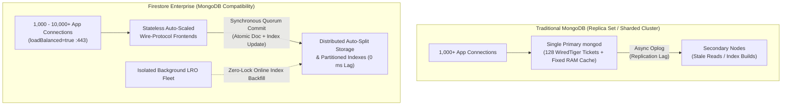

# Firestore Enterprise (MongoDB Compatibility) — Scale & Consistency Benchmark

End-to-end scale benchmark, index execution-plan verifier, and **0-ms secondary index consistency** validation suite for **Google Cloud Firestore Enterprise with MongoDB Compatibility**.

Simulates a high-concurrency outbound voicebot / contact-center dialer workload over a **34-field BSON call document (~1.16 KiB)** while simultaneously driving bulk campaign ingestion, online composite index builds, and zero-delay read-after-write index probes.

---

## Repository Contents

| Path | Description |
| :--- | :--- |
| `firestore_mongodb_benchmark.py` | Multi-process PyMongo scale & consistency benchmark (`all-in-one`, `bau-primary`, and `bulk-worker` roles) with real-time 5-second telemetry dashboard. |
| `scripts/mongo_connect.sh` | One-command `mongosh` launcher using URL-encoded 60-minute `gcloud` OAuth2 access tokens. |
| `scripts/live_validation_queries.js` | Interactive / batch `mongosh` validation suite: `COLLSCAN` vs. `IDXSCAN` `.explain("executionStats")` proofs, composite index verification, **0-ms secondary index consistency** proofs, document counts, and logical BSON sizing. |
| `scripts/check_storage_size.py` | Queries Cloud Monitoring (`data_and_index_storage_bytes`) to report total Firestore Enterprise **Data + Index** storage in GiB / GB. |
| `requirements.txt` | Python dependencies (`pymongo>=4.6.0,<5.0.0`). |

---

## Why This Benchmark Exists: MongoDB Scaling Challenges vs. Firestore Enterprise Architecture

High-concurrency operational workloads—such as real-time outbound dialers, order-processing pipelines, and live telemetry platforms—must sustain thousands of low-latency point reads, sorted queue polls, aggregations, and per-event state updates **at the exact same time** that multi-million-document batch uploads and index builds run in the background.

In traditional **MongoDB Replica Sets and Sharded Clusters**, combining these workloads exposes six recurring architectural bottlenecks. **Firestore Enterprise with MongoDB Compatibility** speaks the native MongoDB wire protocol while replacing the single-primary `mongod` + WiredTiger engine with a **decoupled, serverless, multi-zone distributed architecture**:



### 1. Single-Primary Write Bottleneck & WiredTiger Cache Eviction Stalls
- **The Challenge in MongoDB**: Every write in a replica set (`insertMany` campaign loads + live `updateOne` state transitions) funnels through a **single Primary `mongod` VM** and competes for a small pool of **WiredTiger execution tickets** and fixed RAM cache. When a multi-million-document batch load surges dirty cache past WiredTiger's foreground eviction threshold (`~20%`), application threads stall waiting on disk flush I/O—causing live operational P99 latencies to spike into multi-second stalls or `>30s` socket timeouts.
- **How Firestore Enterprise Solves It**: Compute and storage are completely decoupled, with **no single Primary node** and **no VM-bound WiredTiger cache**. Key ranges split and distribute horizontally across independent storage servers automatically. High-throughput batch `insertMany` streams scale across distributed storage splits without starving concurrent sub-15ms operational reads and writes.
- **How This Repo Proves It**: `firestore_mongodb_benchmark.py` runs `500–1,000` live BAU connections (`2,500–5,000 ops/sec`) concurrently alongside a `1M–10M` parallel `insertMany` bulk load while verifying **`0` timeouts**, **`0` `>30s` SLA breaches**, and flat **`~6–14 ms` client-side P50/P99 latency** (`~1–5 ms` server-side).

### 2. Connection Scaling Limits & Per-Socket Memory Overhead
- **The Challenge in MongoDB**: Traditional `mongod` deployments allocate per-connection session/thread overhead on the database VM and enforce strict connection caps per instance tier. Autoscaling microservice fleets to `1,000+` persistent sockets risks exhausting `maxIncomingConnections`, spiking Primary CPU during TLS connection storms, or forcing premature vertical cluster upgrades.
- **How Firestore Enterprise Solves It**: Clients connect with `loadBalanced=true` over TLS `:443` to a **horizontally auto-scaled stateless frontend tier**. Open client sockets do not pin storage-engine threads or consume database cache memory, supporting thousands of concurrent microservice connections seamlessly without instance-tier ceilings.
- **How This Repo Proves It**: `PoolConnectionTracker` (built on PyMongo's CMAP `ConnectionPoolListener`) establishes and tracks `500–1,000+` simultaneous TLS connections with continuous keepalives and zero connection drops.

### 3. Replication Lag & Stale Secondary Reads vs. Primary Overload
- **The Challenge in MongoDB**: Offloading read queries (`readPreference=secondaryPreferred`) to Secondaries introduces **asynchronous oplog replication lag**, which worsens under heavy batch ingestion. Reading even a few hundred milliseconds behind the Primary causes duplicate record processing, missed opt-out / stop flags, and inconsistent dashboard rollups. Conversely, forcing `readPreference=primary` with `w:"majority"` routes all read and write load back onto the single Primary VM.
- **How Firestore Enterprise Solves It**: Every read and secondary index scan is **strongly consistent by default (`0 ms` lag)** without a single-VM bottleneck. Document mutations and all affected secondary index entries commit **atomically within the same synchronous multi-zone quorum transaction**. The instant `insertOne` or `updateOne` returns, every secondary index reflects the exact committed state—eliminating stale reads and eventual-consistency race conditions.
- **How This Repo Proves It**: Both `scripts/live_validation_queries.js` (Proofs A, B, and C) and the continuous `OnlineIndexAndConsistencyCoordinator` in `firestore_mongodb_benchmark.py` execute **zero-sleep (`0.0 ms` delay) `.hint()` index scans** immediately after inserts and composite-key state updates, proving **`100%` immediate visibility (`0` lag misses)**.

### 4. Online Index Builds Competing with Live Production I/O
- **The Challenge in MongoDB**: Running `createIndex` on a multi-million-document collection scans the entire collection on the Primary and all Secondaries, saturating local disk IOPS, evicting the hot operational working set from WiredTiger RAM, and risking replication lag spikes—often forcing teams to defer index creation to off-peak maintenance windows.
- **How Firestore Enterprise Solves It**: Composite index creation runs as an **isolated, server-managed Long-Running Operation (LRO)** on background infrastructure decoupled from foreground query serving. Zero collection locks are taken, hot operational caches remain untouched, concurrent writes are indexed inline during the backfill, and `100%` of pre-build and mid-build records are immediately queryable the moment the index reaches `READY`.
- **How This Repo Proves It**: At `T+15s` into peak BAU + bulk load, `firestore_mongodb_benchmark.py` triggers an online composite index build on `{ customerCRTId: 1, ..., inserted_on: -1 }`, polls live LRO progress via REST, confirms flat BAU P99 latency throughout the backfill, and immediately verifies all pre-build and mid-build sentinel cohorts via forced `.hint()`.

### 5. Sharding Complexity, Shard-Key Lock-In & Scatter-Gather Queries
- **The Challenge in MongoDB**: Scaling horizontally beyond a single Replica Set requires deploying `mongos` routers, Config Servers, and choosing an upfront shard key. Any query, sort, or `$group` aggregation that cannot filter by the exact shard key triggers a **scatter-gather fan-out across every shard**, degrading tail latency as cluster size grows.
- **How Firestore Enterprise Solves It**: Firestore Enterprise auto-partitions both base documents and **every secondary index independently by its own key prefix**—with zero `mongos` routers, zero manual shard keys, and zero chunk-balancer pauses. Point dedup lookups (`phone_number_input_date`), sorted queue fetches (`flow_id + next_trigger_date`), and customer history queries (`customerCRTId + inserted_on`) **each execute as targeted single-range `IDXSCAN`s** regardless of collection size.
- **How This Repo Proves It**: `scripts/live_validation_queries.js` runs `.explain("executionStats")` across point lookups, sorted queue polls, and `$group` aggregations—demonstrating targeted `IDXSCAN` plans with zero in-memory `SORT` stages and covered index execution.

### 6. Failover Election Pauses & Manual Storage/Tier Provisioning
- **The Challenge in MongoDB**: Primary node failures, OS maintenance, or vertical tier scaling trigger replica-set step-downs and Raft elections that stall writes for seconds and cause application retry bursts, while pre-provisioned disk volumes require capacity planning and manual expansion.
- **How Firestore Enterprise Solves It**: Synchronous multi-zone replication and fine-grained split routing avoid whole-instance Primary failover pauses, while storage and throughput scale elastically from megabytes to petabytes with zero cluster resizing or downtime.

### Architectural Summary Matrix

| Dimension | Traditional MongoDB (Replica Set / Sharded) | Firestore Enterprise (MongoDB Compatibility) | Validated In This Repo By |
| :--- | :--- | :--- | :--- |
| **Write Scaling** | Single Primary `mongod` per replica set / shard; WiredTiger ticket & dirty-cache stalls under batch loads | Serverless auto-split distributed storage; no single-VM bottleneck or cache-eviction pauses | `1M–10M` `insertMany` load concurrent with `5,000` BAU ops/s (`<15 ms` P99) |
| **Concurrent Connections** | Per-socket memory overhead & tier connection caps on `mongod` | Stateless auto-scaled `:443` frontends (`loadBalanced=true`); no fixed socket ceiling | `500–1,000+` live pooled TLS sockets tracked via CMAP listener |
| **Index Consistency** | Async oplog lag on Secondaries (`secondaryPreferred` risks stale reads) | Atomic synchronous quorum commit across document + all secondary indexes (`0 ms` lag) | Continuous `0.0 ms` write $\rightarrow$ `.hint()` `IDXSCAN` probes (`0` lag misses) |
| **Online Index Builds** | Competes for Primary/Secondary disk IOPS & evicts WiredTiger working set | Isolated background LRO backfill with zero locks & zero foreground latency impact | Mid-load `{ customerCRTId, ..., inserted_on }` online build + sentinel check |
| **Multi-Pattern Queries** | Non-shard-key queries fan out via scatter-gather across shards | Every secondary index is independently range-partitioned for targeted `IDXSCAN` | `.explain("executionStats")` across dedup, sorted queue, and `$group` queries |
| **Operations & Capacity** | Manual tier sizing, disk expansion, shard key design, election failovers | Zero-ops serverless scaling, multi-zone HA, pay-for-use storage & units | Zero config changes from `100k` smoke test to `10M+` multi-VM scale runs |

---

## Workload Architecture

`firestore_mongodb_benchmark.py` runs four concurrent workloads against a 34-field BSON document schema:

1. **Sustained BAU Operational Traffic (500 – 1,000+ Live TLS Connections, 2,500 – 5,000+ Ops/sec)**
   - **48% Point Lookups**: 70% full 34-field `_id` fetches + 30% index-covered `phone_number_input_date` lead-deduplication checks.
   - **20% Dialer Queue Fetches**: Index-covered `find().sort({ next_trigger_date: 1 }).limit(10)` with zero in-memory `SORT`.
   - **2% Live Campaign Aggregations**: Covered `$match` + `$group` status & connect-count rollups.
   - **30% Live Call-State Updates**: Disjoint per-thread active call ownership (`85%` mid-call utterance turns appending to `conversation_log` + `15%` terminal call-disposition updates transitioning composite index keys).
2. **Parallel Bulk Campaign Ingestion (1M – 10M Documents)**
   - Staggered `insert_many(..., ordered=False)` worker pool with configurable rate pacing (`--bulk-target-rate`) or unthrottled saturation (`--bulk-target-rate 0`).
3. **Concurrent Online Composite Index Build**
   - Triggers an online composite index build (`{ customerCRTId: 1, ..., inserted_on: -1 }`) mid-benchmark with zero write locks, polling Firestore LRO progress via REST and verifying 100% sentinel visibility immediately upon completion.
4. **Zero-Delay (`0.0 ms`) Secondary Index Consistency Probe**
   - Continuously inserts fresh document cohorts and—with **zero sleep (`0.0 ms`)**—queries them back via forced `.hint()` secondary index scans, tracking `PASS / Lag Miss` counts in real time.

---

## 1. Prerequisites & Setup

1. **Firestore Enterprise Database (MongoDB Compatibility)** created in the same region as your benchmark VM(s) (for example, `asia-south1` or `us-central1`):
   ```bash
   export PROJECT_ID="<YOUR_GCP_PROJECT_ID>"
   export DB_ID="voicebot-demo"
   export REGION="asia-south1"

   gcloud firestore databases create \
     --database="${DB_ID}" \
     --location="${REGION}" \
     --type=firestore-native \
     --edition=enterprise \
     --mongodb-compatible-data-access \
     --project="${PROJECT_ID}"
   ```
2. **Client VM Recommendations** (for 1,000+ connections & 5,000+ BAU ops/sec):
   - Two `e2-highcpu-16` GCE VMs in the **same region** as the database, with **Private Google Access** enabled on the subnet and `cloud-platform` OAuth scope.
   - Ensure the caller / VM service account has `roles/datastore.user` (data plane + index DDL) and `roles/monitoring.viewer` (optional, for `scripts/check_storage_size.py`).
3. **Install Python Virtual Environment & Raise File Descriptor Limit** (run on each VM):
   ```bash
   sudo apt-get update && sudo apt-get install -y python3-venv python3-pip
   python3 -m venv ~/bench-venv
   source ~/bench-venv/bin/activate
   pip install --upgrade pip
   pip install -r requirements.txt

   # Raise open socket limit in every new SSH session before running 500-1,000+ connections:
   ulimit -n 65535
   ```
   > **Tip:** After reconnecting a terminal session, always re-activate the virtual environment (`source ~/bench-venv/bin/activate`) and run `ulimit -n 65535` so `bson` / `pymongo` are on `PYTHONPATH`.

---

## 2. Connect via `mongosh` & Run Live Index / Consistency Proofs

Make the helper scripts executable once:
```bash
chmod +x scripts/mongo_connect.sh scripts/check_storage_size.py firestore_mongodb_benchmark.py
```

### Interactive `mongosh` Login
```bash
./scripts/mongo_connect.sh --project "${PROJECT_ID}" --database "${DB_ID}"
```

### Run End-to-End Plan & Zero-Delay Consistency Validation
Executes `COLLSCAN` $\rightarrow$ `IDXSCAN` `.explain("executionStats")` comparisons, composite index checks, and **3 live `0 ms` synchronous index consistency proofs** on a dedicated `calls_phase1_demo` collection:
```bash
./scripts/mongo_connect.sh \
  --project "${PROJECT_ID}" \
  --database "${DB_ID}" \
  --file scripts/live_validation_queries.js
```

---

## 3. Running the Scale Benchmark

The benchmark automatically constructs and refreshes 60-minute OAuth2 `MONGODB_URI` tokens via `gcloud` (or accepts an explicit `export MONGODB_URI="mongodb://..."` using SCRAM-SHA-256 or `PLAIN` auth).

### Option A: Quick Single-Machine Smoke Test (`100` Conns, `500` BAU Ops/s, `100k` Bulk Docs)
```bash
source ~/bench-venv/bin/activate
ulimit -n 65535

python3 firestore_mongodb_benchmark.py \
  --preset local-smoke \
  --project "${PROJECT_ID}" \
  --database "${DB_ID}" \
  --collection calls
```

### Option B: 2-VM Isolated Full-Scale Benchmark (`1,000` BAU Conns @ `5,000` Ops/s + `6M` Bulk Load)

Run **VM 1 (`bau-primary`)** and **VM 2 (`bulk-worker`)** with a matching `--run-id`. The two VMs automatically coordinate warmup and release simultaneously via Firestore.

**On VM 1 (BAU Primary + Online Index Coordinator + Live Telemetry Dashboard):**
```bash
source ~/bench-venv/bin/activate
ulimit -n 65535

python3 firestore_mongodb_benchmark.py \
  --role bau-primary \
  --run-id live-scale-run \
  --project "${PROJECT_ID}" \
  --database "${DB_ID}" \
  --collection calls \
  --bau-conns 1000 \
  --bau-procs 16 \
  --threads-per-proc 24 \
  --target-bau-ops 5000
```

**On VM 2 (Dedicated Parallel Bulk Ingestion Tier):**
```bash
source ~/bench-venv/bin/activate
ulimit -n 65535

python3 firestore_mongodb_benchmark.py \
  --role bulk-worker \
  --run-id live-scale-run \
  --project "${PROJECT_ID}" \
  --database "${DB_ID}" \
  --collection calls \
  --bulk-docs 6000000 \
  --bulk-workers 16 \
  --bulk-batch-size 100 \
  --bulk-target-rate 4000
```

### Option C: Custom 500-Connection / 1M-Doc Steady-State Profile (Skipping Online Index Rebuild)
To measure pure BAU + Bulk steady-state latency without triggering a mid-run online index build, set `--index-trigger-delay 9999999`:

- **VM 1 (`bau-primary`)**:
  ```bash
  python3 firestore_mongodb_benchmark.py \
    --role bau-primary \
    --run-id live-500conn-run \
    --project "${PROJECT_ID}" \
    --database "${DB_ID}" \
    --collection calls \
    --bau-conns 500 \
    --bau-procs 8 \
    --threads-per-proc 8 \
    --target-bau-ops 2500 \
    --index-trigger-delay 9999999
  ```
- **VM 2 (`bulk-worker`)**:
  ```bash
  python3 firestore_mongodb_benchmark.py \
    --role bulk-worker \
    --run-id live-500conn-run \
    --project "${PROJECT_ID}" \
    --database "${DB_ID}" \
    --collection calls \
    --bulk-docs 1000000 \
    --bulk-workers 8 \
    --bulk-batch-size 100 \
    --bulk-target-rate 2500
  ```

---

## 4. Useful `mongosh` & Storage Inspection Commands

Inside `mongosh` (`./scripts/mongo_connect.sh --project "${PROJECT_ID}" --database "${DB_ID}"`):

```javascript
// 1. List all indexes on the collection
db.calls.getIndexes()

// 2. Get exact total document count
db.calls.countDocuments()

// 3. Estimate logical BSON payload size in GiB / GB from a 10,000-doc sample
const totalDocs = db.calls.countDocuments();
const avgBytes = db.calls.aggregate([
  { $limit: 10000 },
  { $group: { _id: null, avg: { $avg: { $bsonSize: "$$ROOT" } } } }
]).toArray()[0].avg;
print(`Docs: ${totalDocs.toLocaleString()} | Avg: ${avgBytes.toFixed(1)} B | Logical Size: ${(totalDocs * avgBytes / 1024 ** 3).toFixed(2)} GiB`);
```

To check **total billed storage (Data + Indexes)** from Cloud Monitoring:
```bash
python3 scripts/check_storage_size.py --project "${PROJECT_ID}" --database "${DB_ID}"
```

---

## 5. Monitoring Performance in Google Cloud Console

Open **Google Cloud Console $\rightarrow$ Firestore $\rightarrow$ Databases $\rightarrow$ `<DB_ID>`** and inspect the left-hand observability tabs:

1. **Monitoring** (Primary server-side golden signals — zero client/network RTT):
   - **Active Connections**: Confirms live open MongoDB wire-protocol TLS sockets (e.g., `500` or `1,000` BAU + bulk worker pools).
   - **Document Reads / Writes / Deletes**: Tracks server-side read/write throughput across BAU + Bulk load.
   - **Latency (`p50` / `p99`)**: Displays server-side execution latency (typically `~1–5 ms` server-side vs. `~10–14 ms` client-side including TLS + VPC RTT).
   - **Database Storage Size**: Total stored bytes broken down by document data and index entries.
2. **Query insights**:
   - Identifies top query shapes by total execution time, read units, and execution count, confirming secondary index scans (`IDXSCAN`) with `1:1` keys-to-documents ratios.
3. **Usage** & **Usage insights**:
   - Tracks billed Read Units and Write Units over 1-minute / 1-hour windows.
